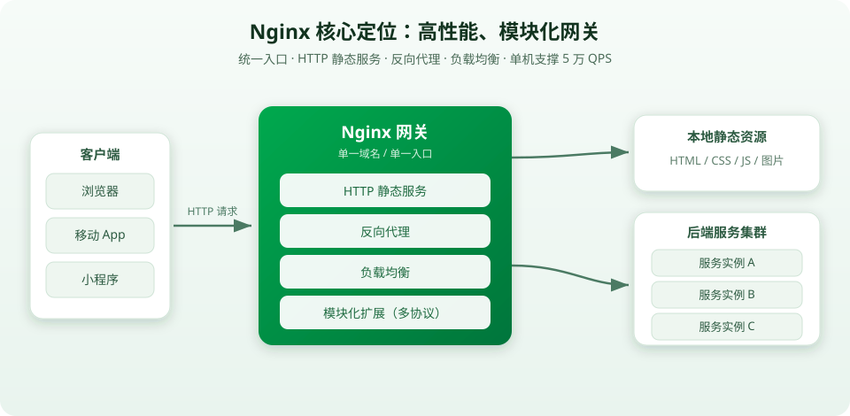
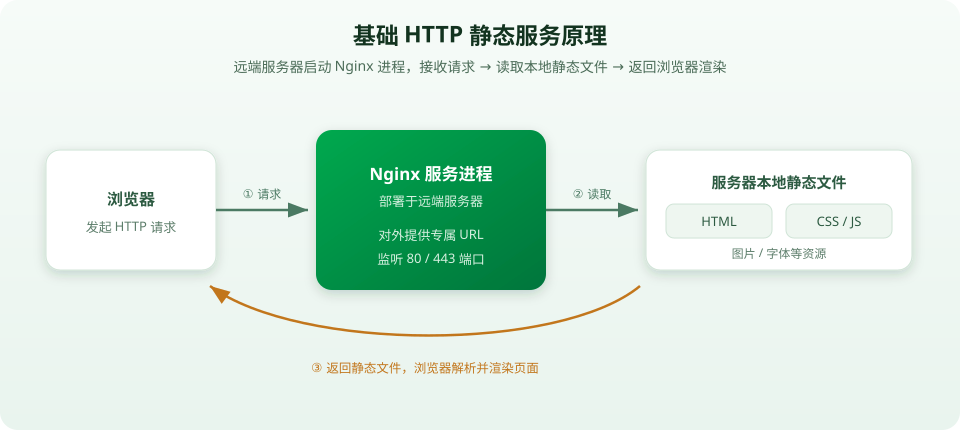
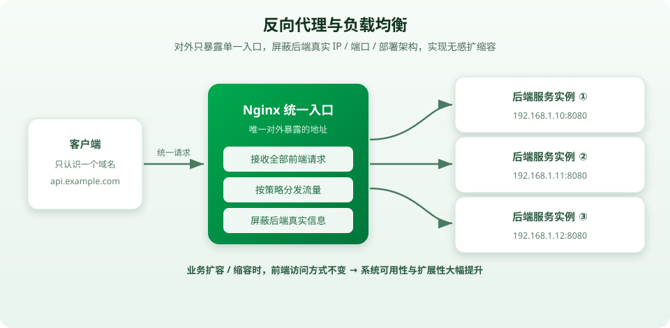
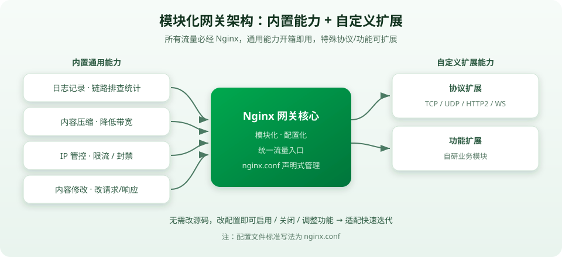
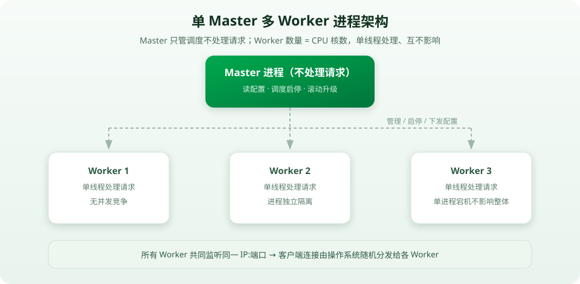
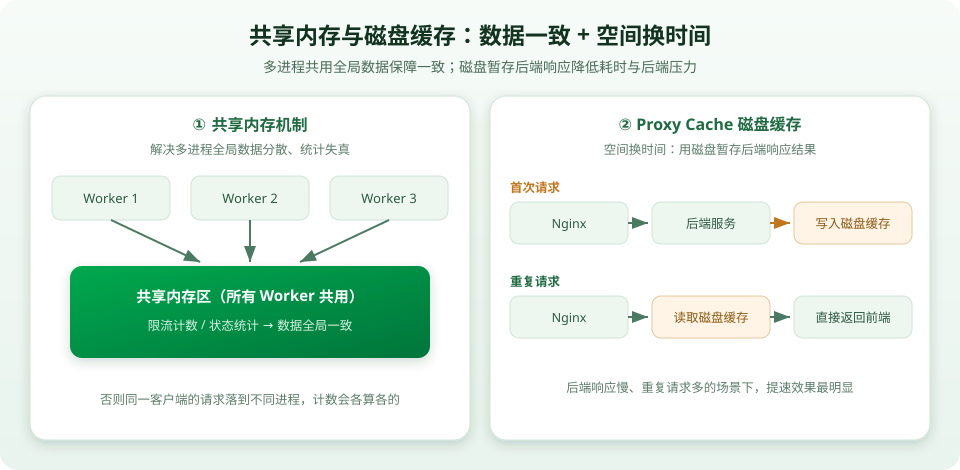
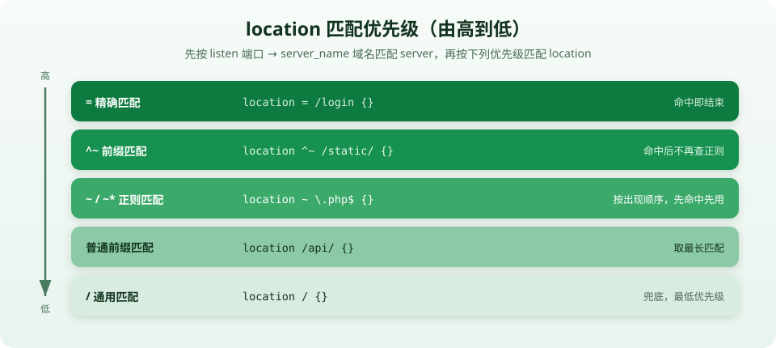
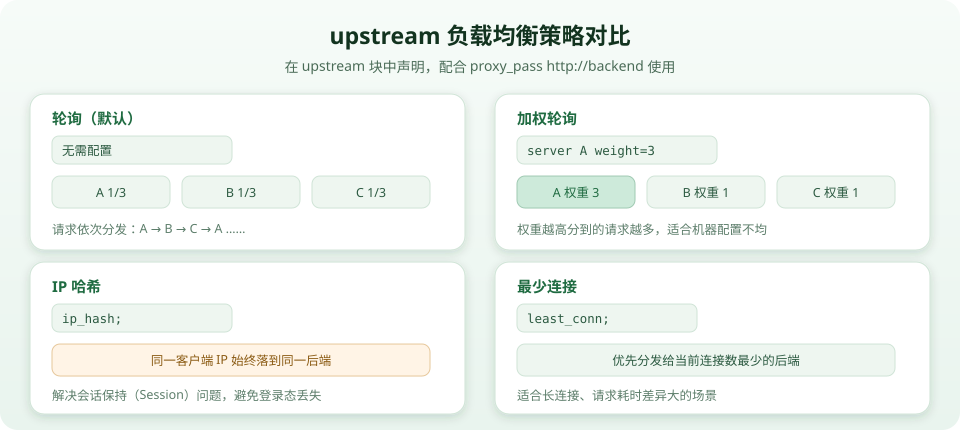

## 一、Nginx核心定位

Nginx 是一款高性能、模块化的网关服务，由基础单进程网络服务迭代演进而来，核心集成**HTTP静态服务、反向代理、负载均衡**三大基础能力，支持多协议扩展、配置化管理、滚动升级，可轻松支撑 5 万 QPS 请求处理，适配绝大多数中小型业务场景，性能冗余充足。



## 二、Nginx基础服务能力（设计演进逻辑）

Nginx 的核心能力遵循「基础网页服务 → 流量转发优化」的业务演进逻辑，解决了前端部署与后端流量分发的核心痛点。

### 2.1 基础HTTP静态服务能力

#### 1）实现原理

在远端服务器启动Nginx服务进程，对外提供专属URL地址；用户通过浏览器发起HTTP请求后，Nginx进程接收请求、读取服务器本地HTML静态文件，返回给浏览器完成页面解析与展示。

#### 2）核心作用

实现前端静态资源（HTML、CSS、JS等）的远端部署，对外提供可公开访问的网页服务，是前端项目线上部署的基础载体。



### 2.2 反向代理与负载均衡能力

#### 1）产生背景

业务流量增长后，单后端服务无法承载压力，需多实例扩容；多后端服务对应独立的IP和端口，浏览器无法自主识别、匹配请求目标，出现流量分发混乱问题。

#### 2）核心设计逻辑

在多后端服务前置统一Nginx入口，对外仅暴露单一域名/URL，屏蔽后端服务器的真实IP、端口和部署架构；所有前端请求统一由Nginx接收，均匀转发至后端多个服务实例，实现**负载均衡**。

#### 3）核心价值

实现后端服务无感扩缩容，业务迭代、服务增减不影响前端访问，大幅提升系统可用性与扩展性。

#### 4）能力融合

Nginx可同时集成静态HTTP服务与反向代理能力，既部署前端页面，又转发页面触发的后端数据请求，实现前后端流量统一调度。



## 三、Nginx模块化网关架构设计

Nginx 采用**模块化、配置化**的网关设计，将通用流量能力封装为内置模块，同时支持自定义扩展，避免业务重复开发，适配多场景网络需求。

### 3.1 内置通用网关能力

所有网络流量必经Nginx网关，原生内置高频通用功能，开箱即用：

- 日志记录：全程记录请求链路信息，便于问题排查、流量统计；
- 内容压缩：对请求/响应内容进行压缩，降低网络带宽消耗；
- IP管控：支持IP限流、恶意IP封禁，保障服务安全稳定；
- 内容修改：可按需修改请求、响应的报文内容。

### 3.2 自定义扩展机制

Nginx 开放模块扩展接口，突破原生能力限制：

- 协议扩展：原生支持HTTP，可自定义模块扩展适配TCP、UDP、HTTP2、WebSocket等主流网络协议；
- 功能扩展：用户可根据业务需求，自主开发专属功能模块，适配个性化业务场景。

### 3.3 配置化管理模式

通过 `nginx.config` 配置文件统一管理所有能力，无需修改服务源码，仅通过配置声明即可启用、关闭、调整功能模块，操作简洁、灵活，适配快速迭代的业务需求。



## 四、Nginx多进程核心运行机制

Nginx 采用**单Master多Worker**的经典进程架构，兼顾运行效率、服务稳定性与迭代灵活性，从底层规避并发问题、保障高可用。

### 4.1 单线程处理核心逻辑

单个Worker进程内部采用**单线程处理所有请求**，彻底规避多线程并发竞争问题，消除线程切换的性能开销，最大化提升单进程请求处理效率。

### 4.2 多Worker进程设计

#### 1）设计思路

单进程单线程无法承载大流量压力，因此启动多个独立的Worker进程，进程数量与服务器CPU核数保持一致，最大化利用CPU算力。

#### 2）运行特性

- 多Worker进程可同时监听同一IP+端口，由操作系统随机分发流量，实现流量负载分摊；
- 进程相互独立，单个Worker进程故障、宕机不会影响其他进程，保障服务整体可用性。

### 4.3 Master进程协调机制

Master进程为核心调度进程，不处理具体业务请求，仅负责全局管理：

- 读取、解析 `nginx.config` 配置文件，统一下发配置；
- 调度管理所有Worker进程的启动、停止、重启；
- 支持**滚动升级**：逐一启停Worker进程，任意时刻保留正常工作的进程，避免服务整体中断、连接断开，实现业务无感知迭代。



## 五、全局数据与缓存核心机制

针对多进程架构的数据一致性与响应效率问题，Nginx 设计了共享内存与磁盘缓存双重机制，平衡性能与成本。

### 5.1 共享内存机制

#### 1）解决问题

多Worker进程独立处理请求，同一客户端的多次请求可能被不同进程接收，限流计数、状态统计等全局逻辑会出现数据分散、统计失真问题。

#### 2）设计逻辑

为所有Worker进程分配统一的共享内存区域，多进程共用同一份全局数据，保障限流、统计等功能的数据一致性，避免功能异常。

### 5.2 Proxy Cache磁盘缓存机制

#### 1）核心思路

采用**空间换时间**的设计，放弃高成本的内存缓存，使用廉价的服务器磁盘文件暂存后端服务的响应结果。

#### 2）运行逻辑

首次请求：Nginx转发请求至后端，获取响应数据后缓存至磁盘；重复请求：直接读取磁盘缓存数据返回前端，无需再次请求后端服务。

#### 3）核心价值

大幅降低请求响应耗时、减少后端服务压力、降低网络传输负载，在**后端响应慢、重复请求多**的场景下性能提升效果显著。



## 六、Nginx性能优势与场景适配

### 6.1 核心性能指标

原生架构优化加持，Nginx 可轻松支撑 **5万 QPS** 并发请求处理。

### 6.2 场景适配性

绝大多数常规业务服务仅需支撑几十QPS，Nginx性能冗余充足，完全适配中小型网站、后端服务、微服务网关等各类常规业务场景，稳定性与性能兼具。

## 七、Nginx整体架构总结

Nginx 的核心设计是**分层解耦、高效稳定、灵活扩展**：从基础的静态网页服务、流量转发能力出发，通过模块化设计丰富网关功能，依托单Master多Worker进程架构保障高并发、高可用，借助共享内存与磁盘缓存优化数据一致性与响应速度，最终形成一套轻量化、高性能、易配置、可扩展的成熟网关解决方案。

---

> 以上是视频的科普主线（**概念与架构**）。下面在其基础上补充**深入理解与实战落地**，把每个概念落到具体配置与踩坑点上。

## 八、深入：配置文件结构与层级

前面讲了「配置化管理」，这里落到具体文件。Nginx 的能力全部通过配置文件声明，改完配置 **校验 → 重载** 即可生效，无需重启进程。

**配置文件位置（Linux）：**

| 路径 | 说明 |
| --- | --- |
| `/etc/nginx/nginx.conf` | 主配置文件 |
| `/etc/nginx/conf.d/*.conf` | 子配置，被主配置 `include` 引入（推荐按服务拆分） |
| `/var/log/nginx/access.log` | 访问日志 |
| `/var/log/nginx/error.log` | 错误日志 |

**五层结构：**

```nginx
user  nginx;
worker_processes  auto;          # main 全局块：影响整个 Nginx

events {                         # events 块：连接相关
    worker_connections  1024;    # 每个 worker 最大连接数
}

http {                           # http 块：HTTP 相关
    include       mime.types;
    default_type  application/octet-stream;

    server {                     # server 块：一个虚拟主机
        listen       80;
        server_name  example.com;

        location / {             # location 块：按路径匹配
            root   /usr/share/nginx/html;
            index  index.html;
        }
    }
}
```

**层级与继承：** `main → events / http → server → location`。内层未配置的指令继承外层，内层配置覆盖外层。

**常用命令：**

```bash
nginx -t          # 校验配置语法（改完必做）
nginx -s reload   # 平滑重载，不中断已有连接
nginx -s quit     # 优雅停止（处理完当前请求再退出）
nginx -V          # 查看版本与已编译模块
```

## 九、深入：server 与 location 匹配规则

**server 匹配：** 先按 `listen` 端口匹配，再按 `server_name` 域名匹配；都没命中则走默认 server（第一个或标记 `default_server` 的）。

**location 修饰符与优先级：**

| 修饰符 | 含义 | 示例 |
| --- | --- | --- |
| `=` | 精确匹配，最高优先级 | `location = /login {}` |
| `^~` | 前缀匹配，命中后不再检查正则 | `location ^~ /static/ {}` |
| `~` | 正则匹配，区分大小写 | `location ~ \.php$ {}` |
| `~*` | 正则匹配，不区分大小写 | `location ~* \.(png\|jpg)$ {}` |
| 无 | 普通前缀匹配，取最长 | `location /api/ {}` |
| `/` | 通用匹配，最低优先级 | `location / {}` |



**优先级顺序：** `=` > `^~` > `~` / `~*`（按出现顺序）> 最长普通前缀 > `/`

**root 与 alias 的区别（易踩坑）：**

```nginx
location /img/ { root  /data/static; }   # 实际路径 /data/static/img/xxx（root 会拼接 location 路径）
location /img/ { alias /data/static/; }  # 实际路径 /data/static/xxx（alias 直接替换）
```

**try_files（前端 SPA 路由兜底）：**

```nginx
location / { try_files $uri $uri/ /index.html; }
```

## 十、深入：反向代理实战（proxy_pass）

```nginx
location /api/ {
    proxy_pass http://127.0.0.1:8080/;
    proxy_set_header Host              $host;
    proxy_set_header X-Real-IP         $remote_addr;
    proxy_set_header X-Forwarded-For   $proxy_add_x_forwarded_for;
    proxy_set_header X-Forwarded-Proto $scheme;
}
```

**`proxy_pass` 结尾斜杠的坑（高频问题）：**

| 写法 | 请求 `/api/user` 实际转发到 |
| --- | --- |
| `proxy_pass http://host:8080/;`（带 `/`） | `http://host:8080/user`（替换掉 location 路径） |
| `proxy_pass http://host:8080;`（不带 `/`） | `http://host:8080/api/user`（保留完整原路径） |

**透传请求头：** `X-Real-IP` 客户端真实 IP、`X-Forwarded-For` 代理链路、`X-Forwarded-Proto` 原始协议。Go 后端（如 Gin 的 `c.ClientIP()`）依赖这些头才能拿到真实客户端地址——网关不透传，后端只能看到 Nginx 的 IP。

## 十一、深入：负载均衡实战（upstream）

```nginx
upstream backend {
    server 192.168.1.10:8080 weight=3;   # 权重 3，分到更多流量
    server 192.168.1.11:8080;            # 默认权重 1
    server 192.168.1.12:8080 backup;     # 备用机，其他都挂了才启用
    server 192.168.1.13:8080 down;       # 手动下线
}
server { location / { proxy_pass http://backend; } }
```



**健康检查：** 开源版为**被动检查**，`server ... max_fails=3 fail_timeout=30s;` 表示 30s 内失败 3 次则暂时剔除该节点，超时后再试探恢复。

## 十二、深入：动静分离、gzip 与静态资源优化

**动静分离**：静态资源由 Nginx 直接返回，动态请求转发后端，减轻后端压力。

```nginx
server {
    # 静态资源：Nginx 直接处理并设置浏览器缓存
    location ~* \.(jpg|png|gif|css|js|ico)$ {
        root /data/www;
        expires 7d;
        add_header Cache-Control "public";
    }
    # 动态请求：转发给后端
    location /api/ { proxy_pass http://backend; }
}
```

**gzip 压缩**（对文本类响应压缩后再传输，节省带宽）：

```nginx
http {
    gzip on;
    gzip_min_length 1k;
    gzip_comp_level 5;                # 1-9，越大越省带宽但越耗 CPU
    gzip_types text/plain text/css application/json application/javascript;
    gzip_vary on;
}
```

## 十三、深入：HTTPS 与 SSL 终止

```nginx
server {
    listen 443 ssl;
    server_name example.com;
    ssl_certificate     /etc/nginx/ssl/example.com.crt;
    ssl_certificate_key /etc/nginx/ssl/example.com.key;
    ssl_protocols       TLSv1.2 TLSv1.3;
    location / { proxy_pass http://backend; }
}

# HTTP 自动跳转 HTTPS
server {
    listen 80;
    server_name example.com;
    return 301 https://$host$request_uri;
}
```

网关做 **SSL 终止**：客户端到 Nginx 走 HTTPS，Nginx 到后端走内网 HTTP，后端无需处理证书与加解密。

## 十四、深入：限流与安全防护

**请求速率限流（漏桶算法）：**

```nginx
http {
    limit_req_zone  $binary_remote_addr zone=req_limit:10m rate=10r/s;   # 按 IP 限速
    limit_conn_zone $binary_remote_addr zone=conn_limit:10m;             # 按 IP 限并发

    server {
        location /api/ {
            limit_req  zone=req_limit burst=20 nodelay;  # 允许突发 20，nodelay 立即处理
            limit_conn conn_limit 5;                     # 单 IP 最多 5 个并发连接
            proxy_pass http://backend;
        }
    }
}
```

- `limit_req`：限制**请求速率**；`burst` 允许突发排队，`nodelay` 让突发请求立即处理而不排队延迟。
- `limit_conn`：限制单 IP **并发连接数**。
- 超限默认返回 `503`，可用 `limit_req_status 429;` 自定义状态码。

**IP 白名单 / 黑名单：**

```nginx
location /admin/ {
    allow 192.168.1.0/24;
    deny  all;
}
```

## 十五、深入：代理缓存实战

把第五节的「Proxy Cache 磁盘缓存」原理落成配置：

```nginx
http {
    proxy_cache_path /var/cache/nginx levels=1:2 keys_zone=my_cache:10m max_size=1g inactive=60m;

    server {
        location /api/ {
            proxy_cache my_cache;
            proxy_cache_valid 200 10m;                          # 200 响应缓存 10 分钟
            add_header X-Cache-Status $upstream_cache_status;   # HIT / MISS，便于调试
            proxy_pass http://backend;
        }
    }
}
```

## 十六、深入：日志与问题排查

**自定义访问日志：**

```nginx
log_format main '$remote_addr - [$time_local] "$request" $status '
                '$body_bytes_sent "$http_user_agent" $upstream_response_time';
access_log /var/log/nginx/access.log main;
```

**常见问题排查表：**

| 现象 | 排查方向 |
| --- | --- |
| 502 Bad Gateway | 后端服务没起来 / 端口写错 / 后端崩溃 |
| 504 Gateway Timeout | 后端处理超时，调大 `proxy_read_timeout` |
| 404 Not Found | `root` / `alias` 路径错误，或 location 匹配错 |
| 转发后路径不对 | 检查 `proxy_pass` 结尾斜杠 |
| 后端拿不到真实 IP | 是否透传 `X-Real-IP` / `X-Forwarded-For` |
| 413 Request Entity Too Large | 调大 `client_max_body_size` |
| 改配置不生效 | 是否 `nginx -t` 校验并 `nginx -s reload` |

**常用超时与大小配置：**

```nginx
location /api/ {
    proxy_connect_timeout 5s;      # 与后端建立连接超时
    proxy_read_timeout    60s;     # 读取后端响应超时
    proxy_send_timeout    60s;     # 向后端发送请求超时
    client_max_body_size  50m;     # 允许的请求体最大大小
}
```

## 十七、总结：概念 + 实战

1. **定位**：Nginx 是高性能、模块化的网关服务，集成 HTTP 静态服务、反向代理、负载均衡，是微服务架构的统一入口。
2. **演进逻辑**：基础网页服务 → 流量转发优化，解决前端部署与后端流量分发的痛点。
3. **模块化架构**：内置通用能力（日志、压缩、IP 管控、内容修改）+ 自定义扩展（多协议、自研模块），配置化声明管理。
4. **进程模型**：单 Master 多 Worker，Worker 单线程、数量 = CPU 核数，滚动升级实现无感迭代。
5. **全局数据与缓存**：共享内存保障限流/统计一致性；Proxy Cache 磁盘缓存「空间换时间」。
6. **实战配置**：配置文件层级、location 匹配优先级、`proxy_pass` 斜杠、upstream 策略、动静分离、gzip、HTTPS、限流、代理缓存、日志排查。
7. **运维习惯**：改配置 → `nginx -t` 校验 → `nginx -s reload` 平滑生效。
8. **与后端配合**：正确透传 `Host`、`X-Real-IP`、`X-Forwarded-For`，后端才能拿到真实客户端信息。
